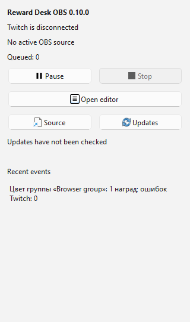
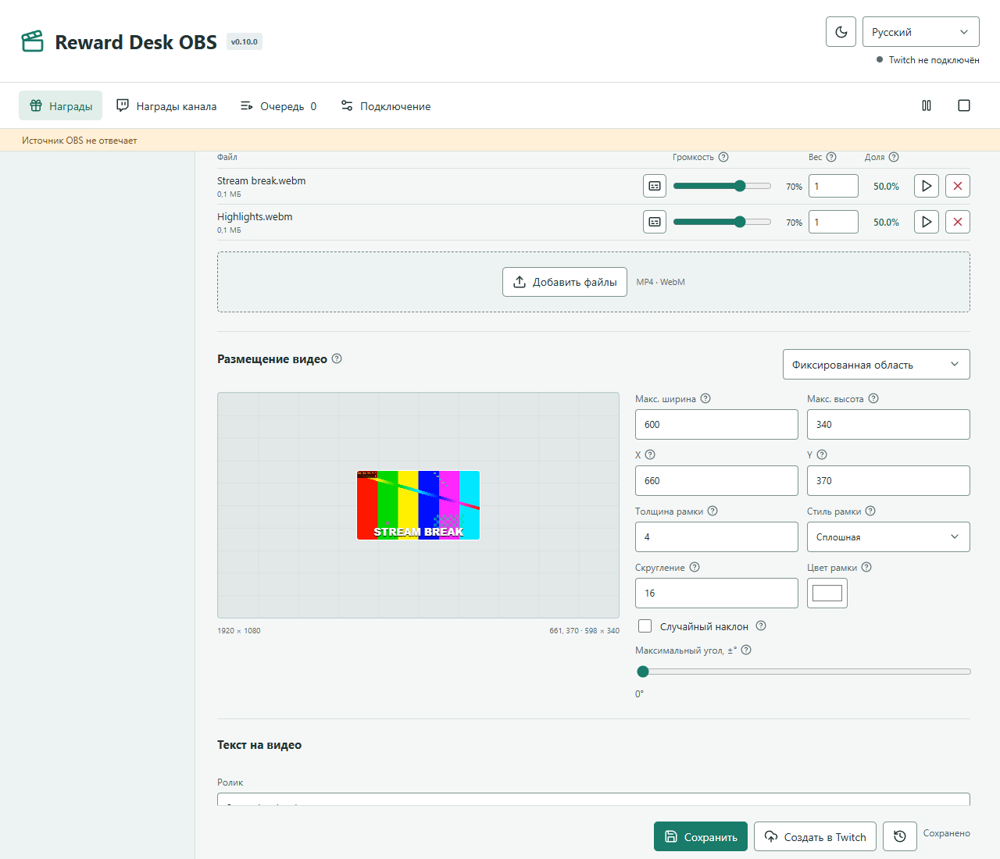
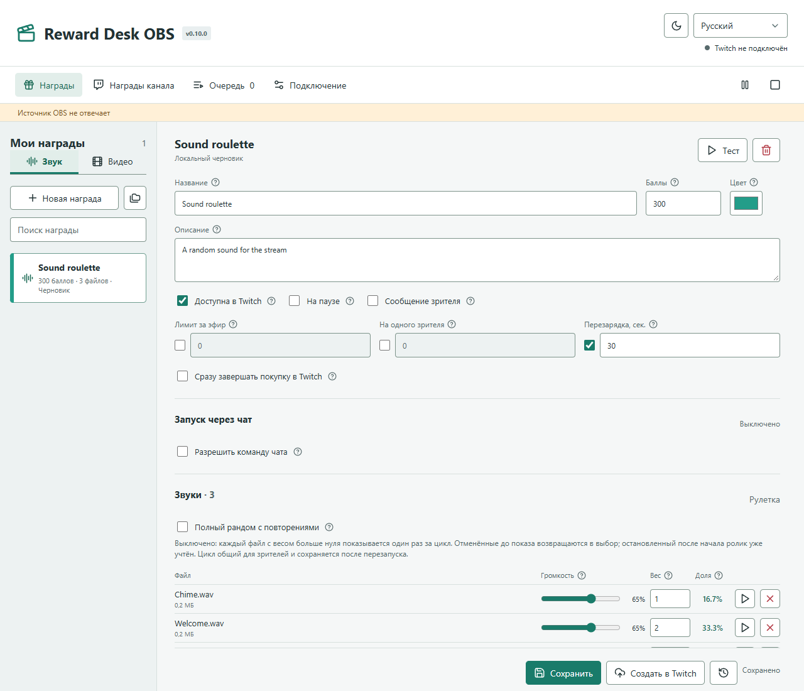

# Reward Desk OBS

Самостоятельный бесплатный плагин для OBS Studio 32+ на Windows 10/11 x64: звуковые и видео-награды Twitch, рулетки, очередь и локальный редактор. Streamer.bot и отдельное приложение Reward Desk не нужны.

[Скачать плагин 0.10.0](https://github.com/foolka/reward-desk-obs/releases/tag/v0.10.0) · [Инструкции и скриншоты](https://fermionaplay.win/ru/apps/reward-desk-obs/) · [Отдельное приложение](https://github.com/foolka/reward-desk)



## Возможности

- Компактная док-панель: пауза, остановка текущего показа, очередь, состояния Twitch и источника, последние события и обновления.
- Полный локальный редактор открывается в браузере кнопкой панели. Награды, загрузка файлов, группы, тексты и настройки остаются на вашем ПК.
- Создание, редактирование и удаление наград Twitch: название, описание, цена, цвет, сообщение зрителя, лимиты и перезарядка. Другие награды канала доступны для просмотра; Twitch разрешает изменять только награды той же регистрации приложения.
- Звук или видео одним файлом либо рулеткой. По умолчанию каждый доступный файл выпадает один раз за цикл, без повторов между зрителями; прогресс сохраняется. Можно включить полный рандом с повторениями. У каждого файла свои вес и громкость.
- Бесплатные команды чата с явным списком разрешённых ников и задержкой между активациями.
- Размещение видео с перетаскиванием на превью, случайная позиция и наклон, максимальные размеры, рамка и скругление.
- Своя подпись у каждого ролика, отдельный слой длительности, девять быстрых позиций, X/Y, размер, шрифт и цвет.
- Группы наград, общий цвет в редакторе и Twitch, тесты, очередь и история.
- Постоянный защищённый источник OBS 1920×1080, переподключение и опциональное восстановление зависшего источника. Несколько копий источника не дублируют звук.
- Светлая/тёмная темы, русский, украинский и английский без перезапуска.
- Автосохранение черновиков, история 50 сохранений, копия SQLite при старте, шифрование входа Twitch через Windows DPAPI.



## Установка

1. Скачайте `reward-desk-obs-0.10.0-windows-x64-setup.exe` и сверьте SHA-256 из того же выпуска.
2. Вне эфира и записи закройте OBS через «Выход». Установщик не завершает процессы принудительно.
3. Запустите установщик и подтвердите системный запрос администратора. Плагин устанавливается в `%PROGRAMDATA%\obs-studio\plugins\reward-desk-obs`. Обычная установка OBS 32+ обязательна; Portable OBS не поддерживается.
4. Откройте OBS, затем «Док-панели → Reward Desk» и «Открыть редактор». Войдите через Twitch. Создавать регистрацию разработчика не требуется.
5. Кнопкой «Источник» скопируйте URL в источник «Браузер» OBS, размер **1920×1080**. Включите управление аудио через OBS и настройте нужные дорожки.

Установщик не подписан сертификатом издателя: Windows может показать SmartScreen. Проверяйте источник и SHA-256, не отключайте защиту Windows. Системные DLL OBS не заменяются.

## Самостоятельный Проект

Этот репозиторий содержит только продукт Reward Desk OBS: собственные исходники, зависимости, тесты, C++-панель, модуль обработки, установщик и канал обновлений. Он собирается без соседнего `reward-desk`, общих папок исходников и Git submodules. Локальное размещение проектов рядом не создаёт зависимости между ними.

Профиль плагина: `%APPDATA%\RewardDeskOBS`. Приложение использует другой профиль `%APPDATA%\RewardDesk`. Вход Twitch, база, медиа, очередь, черновики и ключ источника независимы, автоматического копирования или синхронизации нет. Пользователь выбирает **либо приложение, либо плагин**. Не запускайте оба для одних и тех же наград одновременно.

Регистрация Twitch сохранена для совместимости с уже созданными наградами; отдельные токены хранятся только в соответствующем профиле. Сам по себе публичный Client ID не предоставляет доступ к каналу.

## Обновление С Прежней Версии

Установите 0.10.0 поверх существующего плагина при закрытом OBS. Не удаляйте профиль. Путь установки, ID установщика, имена процессов, порт **18875**, вход и ключ источника не меняются.

Старые версии найдут переходный выпуск `obs-v0.10.0` в прежнем `foolka/reward-desk`. В нём тот же установщик плагина. После обновления проверка использует только этот репозиторий `foolka/reward-desk-obs`, выпуски `v*` и установщики `reward-desk-obs-*`. Новые версии приложения не будут предлагаться плагину. Проверка публичных выпусков не требует входа GitHub; сетевая ошибка не означает, что обновлений нет.

## Данные И Восстановление

- `rewards.sqlite` и WAL содержат настройки, очередь, историю и ключ источника; `media/` содержит импортированные копии файлов.
- Локальная награда и черновик сохраняются без публикации на Twitch. Неопубликованные награды находятся в «Наградах», не в «Наградах канала».
- Для полной резервной копии закройте OBS и скопируйте весь `%APPDATA%\RewardDeskOBS`. Копии SQLite при старте не содержат медиа.
- Обновление и удаление плагина сохраняют профиль. На другом ПК понадобится повторный вход Twitch.
- Защита профиля останавливает запуск при перенаправлении, пропаже или подмене базы, не создавая пустую вместо существующей.
- Одновременно редактирует одна вкладка; устаревшая вкладка не может перезаписать свежие изменения.
- «Восстановить локальные награды» добавляет отсутствующие неопубликованные записи из резервной копии, не заменяя текущие награды, токены и URL.
- Не публикуйте профиль, токены и секретную ссылку OBS. В Git и установщике пользовательских данных нет.

## Воспроизведение И Источник

Модуль работает вместе с OBS; закрытие вкладки редактора не выключает награды. EventSub и REST-проверка дополняют друг друга и не создают дублей покупок. Ожидающие покупки ждут готового источника. Успешный показ подтверждает покупку, ошибка или ручная остановка запрашивает возврат, если Twitch ещё допускает его. Прерванный показ требует решения и не повторяется автоматически. При включённом мгновенном завершении покупки возврат недоступен.

Файлы: MP3, WAV, OGG, M4A, FLAC, MP4 и WebM, до 512 МБ и 10 минут. Совместимость зависит от кодека OBS; рекомендуются H.264/AAC или VP9/Opus. В случайной рулетке используется криптографический генератор с заданными весами; повтор прерванного задания сохраняет ранее выбранный файл.

Источник переподключается сам. Для зависшего или не загрузившегося источника в «Подключении» доступна кнопка «Настроить защиту OBS». Настройки OBS определяются локально, пароль хранится зашифрованным. При выключенном управлении потребуется закрыть OBS вне эфира, выполнить настройку и открыть его снова. Защита обновляет только свой активный браузерный источник, без переключения сцен, остановки эфира или записи. Удалённый источник, чужой URL, занятый порт или падение самого OBS требуют отдельного исправления.



## Сборка И Тесты

Node.js 24.14+, Visual Studio C++ Build Tools, CMake, официальный OBS Qt 6.8 x64 SDK, Inno Setup 6. Для UI-тестов нужны Chrome и FFmpeg.

```powershell
npm ci
npm test
$env:QT_SDK = 'C:\path\to\obs-qt6-sdk'
$env:ISCC_EXE = 'C:\path\to\ISCC.exe'
npm run build
npm run installer
npm run test:obs
```

Все результаты находятся в `release/`. Тесты используют искусственные профили, не подключаются к Twitch и не меняют установленный OBS. [Архитектура и безопасность](docs/obs-plugin.md), [изменения](CHANGELOG.md), лицензия GPL-2.0-or-later. Проект выделен из Reward Desk с сохранением авторства и лицензии.

## English

Independent OBS Studio 32+ plugin for Twitch sound/video rewards. Includes its own native dock, runtime, browser editor, source, installer and updater. No standalone Reward Desk installation or sibling source checkout is needed. Choose the app OR plugin. Upgrade over the existing plugin without deleting `%APPDATA%\RewardDeskOBS`; all data, media and source keys remain in place. Future releases come from `foolka/reward-desk-obs` only. Windows x64, EN/UK/RU, light/dark themes. Unsigned installer: verify its SHA-256.
