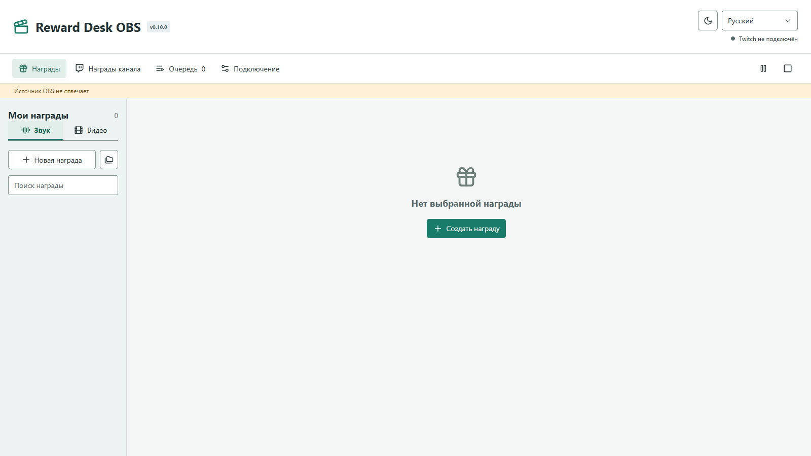

# Reward Desk OBS

Public Windows x64 release for OBS Studio 32+. The OBS plugin and standalone app are alternative products, not two launchers for one database.




## Hearing Rewards In Your Headphones

Enable **Control audio via OBS** in the Browser source properties. Then open Audio Mixer → Advanced Audio Properties and set the Reward Desk OBS source's Audio Monitoring to **Monitor and Output**. In Settings → Audio → Advanced → Monitoring Device, select your headphones (or the headset for VR).

Without monitoring, the source can play to viewers while remaining silent in your headphones; this is not a playback failure. **Monitor Only (mute output)** disables direct output to the stream/recording, so it is not the setting for both you and viewers. Check the source's mixer level, volume and selected output tracks using Test in the editor. If you hear doubled audio, check whether Desktop Audio is capturing the monitored sound again. This applies to sound rewards and video audio alike.

## Isolation

| | App | OBS plugin |
| --- | --- | --- |
| Profile | `%APPDATA%/RewardDesk` | `%APPDATA%/RewardDeskOBS` |
| Runtime | RewardDesk.exe | bundled RewardDeskOBS.exe |
| AppUserModelID | com.fermionaplay.rewarddesk | com.fermionaplay.rewarddeskobs |
| Source port | 18874 | 18875 |
| Repository | foolka/reward-desk | foolka/reward-desk-obs |
| Release tag | vX.Y.Z | vX.Y.Z |

The runtime product identity is fixed in this repository. Neither command-line arguments nor legacy marker files can switch it to the desktop app. Both projects contain their own source, dependencies, build, tests and release pipeline; there are no shared local modules, submodules or sibling project paths. The native dock resolves Windows Roaming AppData explicitly, matching Electron. A native/runtime regression test checks this agreement. No live profile is copied, discovered, merged or overwritten. Credentials use Windows DPAPI. One instance per profile owns SQLite. Do not run both products for the same rewards/account at once.

The native Qt dock launches its own bundled runtime without a visible Electron window. It uses loopback HTTP with a per-process random capability from the plugin profile. Source capability is separate and remains stable across restarts. Dock permissions only cover status, pause, stop, reconnect, opening the editor and checking updates. The browser editor receives a different capability in the URL fragment, removes it from the address bar and has a single-writer lease. Arbitrary file paths, native lifecycle commands and recovery paths are not accepted by the HTTP API. Uploads are streamed with a 512 MiB limit into a unique temporary directory and imported through the existing media validator.

The runtime exits gracefully when its originating OBS process exits. An interrupted started job remains in attention state on next start; it is never replayed silently. Closing the editor tab does not stop playback. Existing source heartbeat/reconnect and optional source-only OBS recovery remain in place.

Profile recovery uses a native Windows folder picker and confirmation; HTTP requests cannot supply a recovery path. Opening the data folder only opens the fixed plugin profile. Recovery accepts missing unpublished local rewards, not a transfer of existing Twitch rewards or credentials. Public updates do not require GitHub credentials. Install plugin updates using its separate installer after closing OBS; never use the app installer for the plugin.

## Build

Requires Node 24.14+, Visual Studio C++ Build Tools, CMake, the official OBS Qt 6.8 x64 SDK and Inno Setup. No Qt/OBS DLLs are copied into OBS itself.

```powershell
npm ci
$env:QT_SDK = 'C:\path\to\obs-qt6-sdk'
$env:ISCC_EXE = 'C:\path\to\ISCC.exe'
npm run build
npm run installer
```

Run `npm test` and `npm run test:obs`. UI tests create isolated profiles and never contact Twitch. With QT_SDK set they also render the real native dock in a separate preview process. The installer only supports normal OBS 32+ installations, uses ProgramData's plugin directory and refuses to install while OBS or RewardDeskOBS.exe is running. The standalone app can stay open.

## Upgrade From The Combined Repository

Install 0.10.0 over the existing OBS plugin, without uninstalling or deleting its profile. Installer identity, runtime name, profile, Twitch Client ID and source port are unchanged. The old `foolka/reward-desk` repository provides one `obs-v0.10.0` transition release with the same plugin installer, so older versions can discover it. Version 0.10.0 and later check only `foolka/reward-desk-obs` and stable `v*` tags. The desktop installer is never accepted. An old copy of the desktop app is not a dependency.
